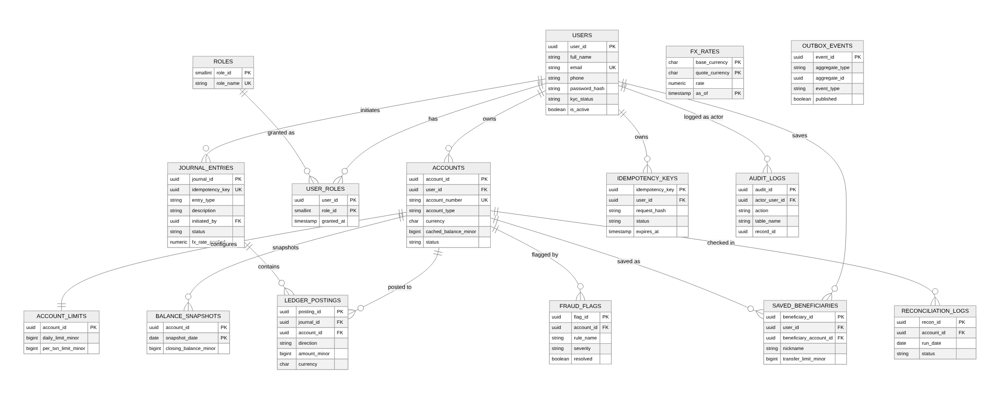

# LedgerCore

**A concurrency-controlled, double-entry transactional ledger** — the engine that sits underneath any product that moves money between accounts (a bank, a wallet, a marketplace payout system). This is a **database-first** project: the hard, interesting work is almost entirely in PostgreSQL (schema design, concurrency control, Row-Level Security, triggers, partitioning); the Node.js API and React dashboard exist to prove the database design actually works end to end, under real concurrent load, not just in isolated SQL snippets.

> Originally scoped from a brainstorm on resume-worthy DBMS project ideas, then taken well past that scope: multi-currency FX, fraud detection, an outbox-pattern notification system, Redis caching, a full React admin console, a deadlock-free concurrency stress test with captured proof, and a Dockerized one-command deployment.

## Demo

See it working in about two minutes (needs [Docker Desktop](https://www.docker.com/products/docker-desktop/) and Python 3):

```
docker compose up --build          # starts Postgres, Redis, API, worker and dashboard
python3 demo_feature_tour.py       # in a second terminal
```

The tour script calls the real HTTP API (the same endpoints the dashboard uses) and prints a narrated transcript as it goes: accounts, transfers, FX conversion, idempotent retries, fraud flags and admin data. When it finishes, open **http://localhost:8080** and log in with the demo account printed at the top of the output; everything it created is already there to click through.

For a step-by-step walkthrough that labels each database operation (insert, update, delete and the rest) as it runs, use `python3 faculty_live_demo.py`.

The full database design is shown in the [ER diagram](docs/er_diagram.png).

## Why this is a hard problem

A ledger isn't just a table of balances. Money needs to:
- **Never be created or destroyed** — every transfer is two (or more) postings that sum to zero, enforced by the database itself, not application code that could have a bug.
- **Survive concurrent access** — thousands of transfers hitting the same accounts simultaneously must never deadlock, double-spend, or drop money.
- **Survive network retries** — a client that times out and retries a transfer must never charge twice.
- **Be auditable and immutable** — once written, a ledger entry can never be silently changed; corrections are new entries, not edits.
- **Enforce access control close to the data** — even if application code has a bug, one customer should not be able to read or move another customer's money.

Every one of those claims below is backed by something you can run and see fail if the guarantee were removed — not just asserted.

## Architecture

```
                         ┌─────────────────┐
                         │  React Dashboard │  (Vite + TS, nginx in prod)
                         │   /accounts      │
                         │   /admin console │
                         └────────┬─────────┘
                                  │ HTTPS/JSON
                         ┌────────▼─────────┐        ┌──────────────┐
                         │   Express API     │───────▶│    Redis     │
                         │  (Node.js + TS)   │  cache │ (cache-aside,│
                         │  JWT auth, RLS    │◀───────│  10s TTL)    │
                         │  session context  │        └──────────────┘
                         └────────┬─────────┘
                                  │ SQL (per-request transaction,
                                  │  RLS context set via set_config)
                         ┌────────▼─────────┐
                         │    PostgreSQL 16  │
                         │ ─────────────────  │
                         │ journal_entries    │  double-entry header
                         │ ledger_postings    │  immutable legs, RANGE partitioned by month
                         │ accounts           │  cached_balance_minor (BIGINT, never float)
                         │ idempotency_keys   │  3-way PROCESSING/COMPLETED/FAILED
                         │ outbox_events      │  transactional outbox
                         │ fraud_flags        │  velocity-based detection
                         │ reconciliation_logs│  nightly ledger-vs-balance check
                         │ Row-Level Security │  every table, session-scoped
                         │ SECURITY DEFINER   │  process_transfer, process_fx_transfer,
                         │   functions        │  process_deposit, process_withdrawal
                         └────────▲─────────┘
                                  │ SQL (admin role context)
                         ┌────────┴─────────┐
                         │  Background Worker │  node-cron schedules:
                         │   (Node.js + TS)   │  outbox dispatch       every 10s
                         │                    │  fraud scan            every 5 min
                         │                    │  settlement refresh    hourly
                         │                    │  reconciliation        daily @ 02:00
                         │                    │  partition maintenance daily @ 02:00
                         └────────────────────┘
```

## Entity-Relationship Diagram



Full relational schema (all 15 relations, PK/FK notation, grouped by area): see [`docs/schema.md`](docs/schema.md).

## What's actually in the database (the core of the project)

- **Double-entry core**: `journal_entries` (the transaction header) + `ledger_postings` (immutable debit/credit legs). A `DEFERRABLE INITIALLY DEFERRED` constraint trigger checks every journal's postings sum to zero **per currency**, at commit time, so multi-leg FX transactions are still provably balanced.
- **Immutability**: a `BEFORE UPDATE OR DELETE` trigger on `ledger_postings` blocks any attempt to alter history — and logs the blocked attempt to `audit_logs` before raising. Corrections are new reversal entries, never edits.
- **Row-Level Security everywhere**: every table's policies key off `app.session_role` / `app.current_user_id`, set per-request via `set_config(..., true)` so RLS context can never leak across pooled connections. A customer's queries are *automatically* scoped to their own data at the database layer — not just by API-level `WHERE user_id = ?` clauses that a bug could omit.
- **Deadlock-free concurrency**: every transfer function locks the two accounts involved in a **deterministic order** (lower `account_id` first, `SELECT ... FOR UPDATE`), which makes a circular wait — and therefore a deadlock — structurally impossible. Proven under load in [`db/benchmarks`](db/benchmarks/README.md).
- **Idempotency**: a `PROCESSING → COMPLETED/FAILED` key table with request-hash validation. A client retry with the same key either replays the original result or is rejected outright if a conflicting request reused the key — money can never move twice because a network call timed out.
- **Multi-currency FX**: transfers between different-currency accounts route through system "clearing accounts" as a 4-leg posting, so the zero-sum invariant holds independently *per currency*, not just in aggregate.
- **Transactional outbox**: notification-worthy events are written to `outbox_events` in the *same transaction* as the ledger posting, then dispatched by a separate worker polling with `FOR UPDATE SKIP LOCKED` — so a crash between "commit the transfer" and "send the notification" can't lose the event.
- **Partitioned at scale**: `ledger_postings` is RANGE-partitioned by month. New partitions are created ahead of need by a scheduled job, and (as proven in the benchmarks) a new index created on the parent table automatically propagates to every future partition.
- **Materialized views refreshed `CONCURRENTLY`**: the admin dashboard's volume chart never blocks or shows a mid-refresh empty result.
- **Fraud detection**: a velocity rule (`COUNT(*) ... HAVING > N` in a rolling window) flags unusual activity — tuned during development to exclude the system's own internal clearing accounts, which otherwise generate permanent false positives by legitimately touching every transaction in the system.
- **Nightly reconciliation**: independently recomputes every account's true balance from ledger history and diffs it against the cached balance, logging `MATCH`/`DRIFT` — the same kind of check real financial systems run to catch any divergence between a fast cache and the source of truth.

Every one of the above was validated against a **live, running PostgreSQL instance** during development, not just written and assumed correct — see "Bugs found and fixed" in [`docs/ARCHITECTURE.md`](docs/ARCHITECTURE.md) for the genuine, non-obvious issues this surfaced (RLS vs. `SECURITY DEFINER` interactions, deferred-trigger privilege context, connection-pool-safe RLS, and more).

## Proven, not asserted: the benchmarks

Full detail, captured `EXPLAIN ANALYZE` output, and raw stress-test logs: **[`db/benchmarks/README.md`](db/benchmarks/README.md)**.

| Claim | Evidence |
|---|---|
| Deadlock-free under heavy concurrent contention | 100 concurrent threads hammering 20 shared accounts for 20s → **14,342 successful transfers, 0 deadlocks, 0 errors**, money conserved to the paisa, 0 accounts drifted on reconciliation |
| Indexing a real query, measured | A compliance-style "large transactions" query: **15.47ms → 0.495ms (≈31x faster)**, full parallel sequential scan → bitmap/index scan, confirmed the index auto-propagated to all 10 monthly partitions with zero manual maintenance |

## Scale this was tested at

The mock data generator (`db/seeds/generate_mock_data.py`) populated and this project has been exercised against:

| Table | Rows |
|---|---|
| `users` | 3,016 |
| `accounts` | 3,063 |
| `journal_entries` | 138,782 |
| `ledger_postings` | 277,564 |

(206,000 of those rows were bulk-loaded via `COPY` in 21.3 seconds, with every single account reconciling cleanly against independently-recomputed ledger history.)

## Tech stack

| Layer | Choice | Why |
|---|---|---|
| Database | PostgreSQL 16 | RLS, deferrable constraint triggers, native partitioning, `SECURITY DEFINER`, `REFRESH ... CONCURRENTLY` — this project leans hard on all of them |
| API | Node.js + TypeScript + Express | `zod` validation, explicit per-request transaction/RLS-context wrapper, JWT auth |
| Cache | Redis (`ioredis`) | Cache-aside with graceful degradation — a Redis outage degrades performance, never correctness |
| Background jobs | Node.js + `node-cron` | Outbox dispatch, fraud scan, settlement refresh, reconciliation, partition maintenance |
| Frontend | React + TypeScript + Vite | Customer dashboard (accounts, live statement, transfers, beneficiaries) + an admin console (fraud, reconciliation, settlement chart via `recharts`, audit trail) |
| Deployment | Docker Compose | Postgres auto-applies every migration on first boot; one command brings up the full stack |

## Running it

### Option A — Docker Desktop (recommended, works the same on Windows/Mac/Linux)

1. Install [Docker Desktop](https://www.docker.com/products/docker-desktop/) and make sure it's running.
2. From the project root:
   ```
   docker compose up --build
   ```
3. First boot automatically applies every file in `db/migrations/` to a fresh Postgres — no manual setup step.
4. Open:
   - Dashboard: **http://localhost:8080**
   - API: **http://localhost:4000** (`/health` to check it's up)
   - Postgres: `localhost:5432` (user `postgres` / password `postgres`, database `ledgercore`) if you want to `psql` in and look around
5. Register an account in the dashboard to get started. To explore the admin console, promote your user to `admin` directly in the database:
   ```sql
   UPDATE user_roles SET role_id = (SELECT role_id FROM roles WHERE role_name = 'admin')
   WHERE user_id = (SELECT user_id FROM users WHERE email = 'you@example.com');
   ```
6. To start over with a clean database: `docker compose down -v` before `up` again.

### Option B — Manual setup (no Docker)

Requires Node.js 20+, PostgreSQL 16, and Redis.

```bash
# 1. Database
createdb ledgercore
for f in db/migrations/*.sql; do psql -d ledgercore -v ON_ERROR_STOP=1 -f "$f"; done

# 2. API
cd api && cp .env.example .env && npm install && npm run dev

# 3. Worker (separate terminal)
cd worker && cp .env.example .env && npm install && npm run dev

# 4. Frontend (separate terminal)
cd frontend && cp .env.example .env && npm install && npm run dev
```

Optional: generate a larger mock dataset to explore at scale (`cd db/seeds && pip install -r requirements.txt && python3 generate_mock_data.py --accounts 500 --transfers 10000`).

## Project layout

```
db/
  migrations/      021 numbered SQL files -- the real source of truth for the schema.
                    Numbered because Postgres's own docker-entrypoint-initdb.d runs
                    them in this exact order on first container boot.
  smoke_test.sql   End-to-end sanity script: transfers, idempotency, immutability, FX
  seeds/           Mock data generator (bulk COPY, solvency-aware, 200k+ rows in ~20s)
  benchmarks/      Concurrency stress test + EXPLAIN ANALYZE indexing proof, with results
api/               Express + TypeScript REST API
worker/            Background jobs (node-cron)
frontend/          React + TypeScript dashboard (Vite)
docs/ARCHITECTURE.md   Deeper design rationale + every real bug found during development
.github/workflows/ci.yml   Migrations + smoke test + stress test + build, on every push
docker-compose.yml
```

## API overview

| Area | Endpoints |
|---|---|
| Auth | `POST /auth/register`, `POST /auth/login` |
| Accounts | `GET/POST /accounts`, `GET /accounts/:id/balance` (cache-aside), `GET /accounts/:id/statement` (passbook, running balance), `GET /accounts/lookup/:accountNumber`, `PATCH /accounts/:id/limits`, `PATCH /accounts/:id/status` (admin) |
| Transfers | `POST /transfers` (idempotent), `POST /transfers/fx`, `POST /transfers/deposit`, `GET /transfers/:journalId` |
| Beneficiaries | full CRUD, scoped by RLS to the caller |
| Admin | `GET /admin/fraud-flags`, `/admin/reconciliation`, `/admin/settlement`, `/admin/audit-logs` (admin/auditor only) |

Full request/response shapes are in the route files under `api/src/routes/` — each one is short and commented with *why*, not just *what*.
