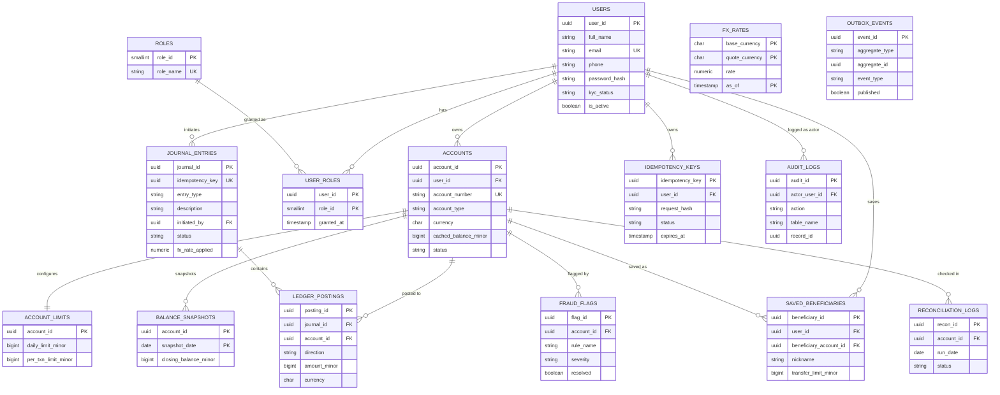

# LedgerCore — Database Schema

ER diagram and relational schema for the LedgerCore database, generated directly from the 21 numbered migration files in `db/migrations/`. PostgreSQL 16, 15 relations, schema in 3NF.

A plain image version of the diagram below is at [`er_diagram.png`](er_diagram.png) (drop that one into a report or slide deck).

## Entity-Relationship Diagram

`FX_RATES` and `OUTBOX_EVENTS` sit apart deliberately — neither is wired with a foreign key: rates are looked up by currency code at the moment a transfer runs, and outbox events reference their journal loosely by UUID so the pattern still works if it's ever split onto its own service.

## Relational Schema

Notation: **bold+underline** = primary key (several bolded attributes on one relation = composite key), `→` = foreign key reference.

### Identity & access

- **Roles**(<u>role_id</u>, role_name)
- **Users**(<u>user_id</u>, full_name, email, phone, password_hash, kyc_status, is_active, created_at, updated_at)
- **User_Roles**(<u>user_id</u>→Users, <u>role_id</u>→Roles, granted_at)
- **Audit_Logs**(<u>audit_id</u>, actor_user_id→Users, action, table_name, record_id, old_value, new_value, created_at)

### Accounts & ledger core

- **Accounts**(<u>account_id</u>, user_id→Users, account_number, account_type, currency, cached_balance_minor, status, created_at, updated_at)
- **Account_Limits**(<u>account_id</u>→Accounts, daily_limit_minor, per_txn_limit_minor, updated_at)
- **Journal_Entries**(<u>journal_id</u>, idempotency_key, entry_type, description, initiated_by→Users, status, fx_rate_applied, source_currency, target_currency, created_at)
- **Ledger_Postings**(<u>posting_id, created_at</u>*, journal_id→Journal_Entries, account_id→Accounts, direction, amount_minor, currency) — *`created_at` is part of the key only because the table is RANGE-partitioned by month; it's not a natural attribute of a posting.
- **Balance_Snapshots**(<u>account_id</u>→Accounts, <u>snapshot_date</u>, closing_balance_minor, last_posting_id, created_at)

### Transaction support

- **Idempotency_Keys**(<u>idempotency_key</u>, user_id→Users, request_hash, response_body, status, created_at, expires_at)
- **Fx_Rates**(<u>base_currency, quote_currency, as_of</u>, rate)
- **Saved_Beneficiaries**(<u>beneficiary_id</u>, user_id→Users, beneficiary_account_id→Accounts, nickname, transfer_limit_minor, added_at)
- **Outbox_Events**(<u>event_id</u>, aggregate_type, aggregate_id, event_type, payload, published, published_at, created_at)

### Oversight

- **Fraud_Flags**(<u>flag_id</u>, account_id→Accounts, rule_name, detail, severity, resolved, created_at)
- **Reconciliation_Logs**(<u>recon_id</u>, account_id→Accounts, run_date, expected_balance_minor, actual_balance_minor, status, created_at)

---

*Generated from `db/migrations/001`–`021`. See [`ARCHITECTURE.md`](ARCHITECTURE.md) for design rationale and the real bugs found during development.*
